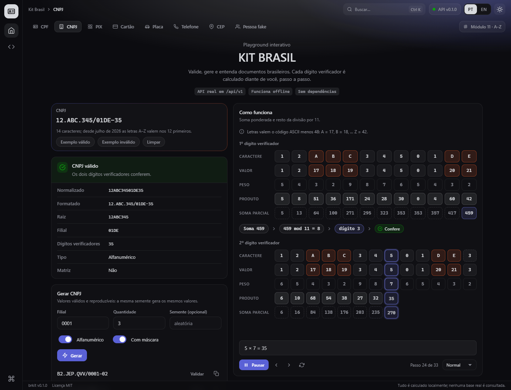
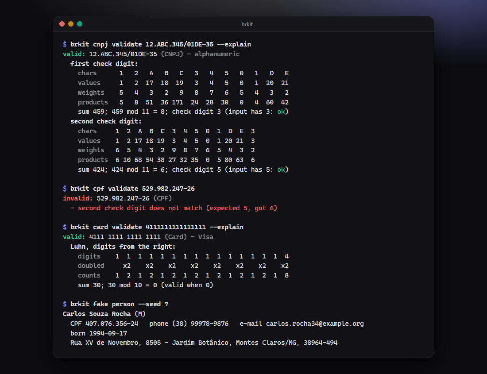
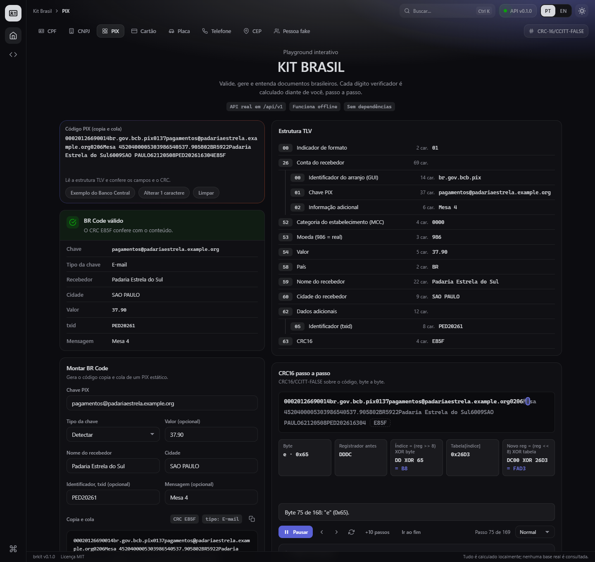
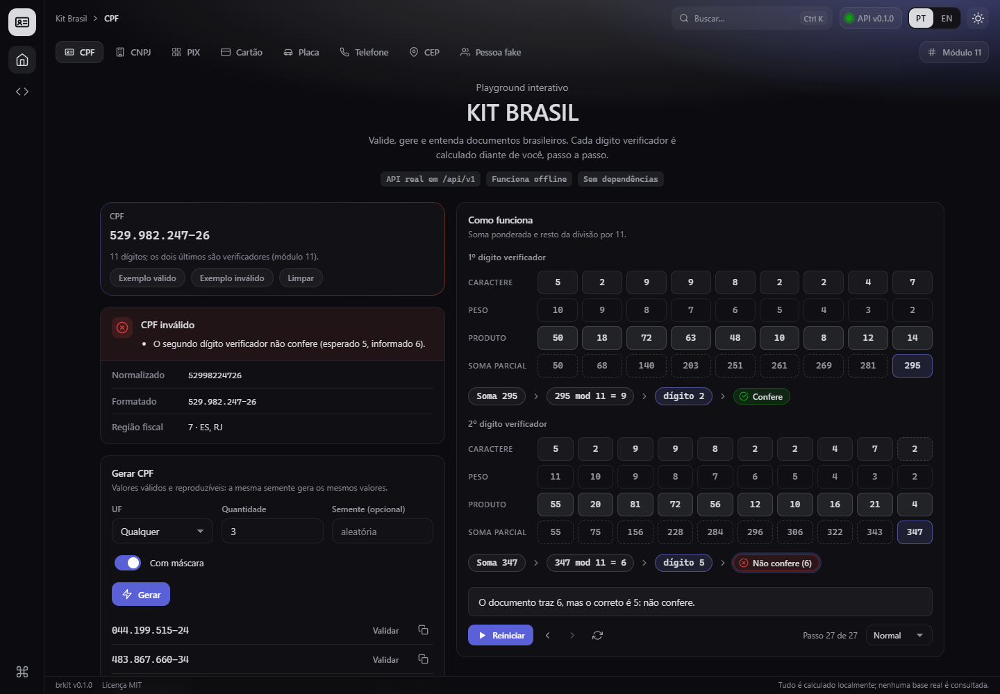
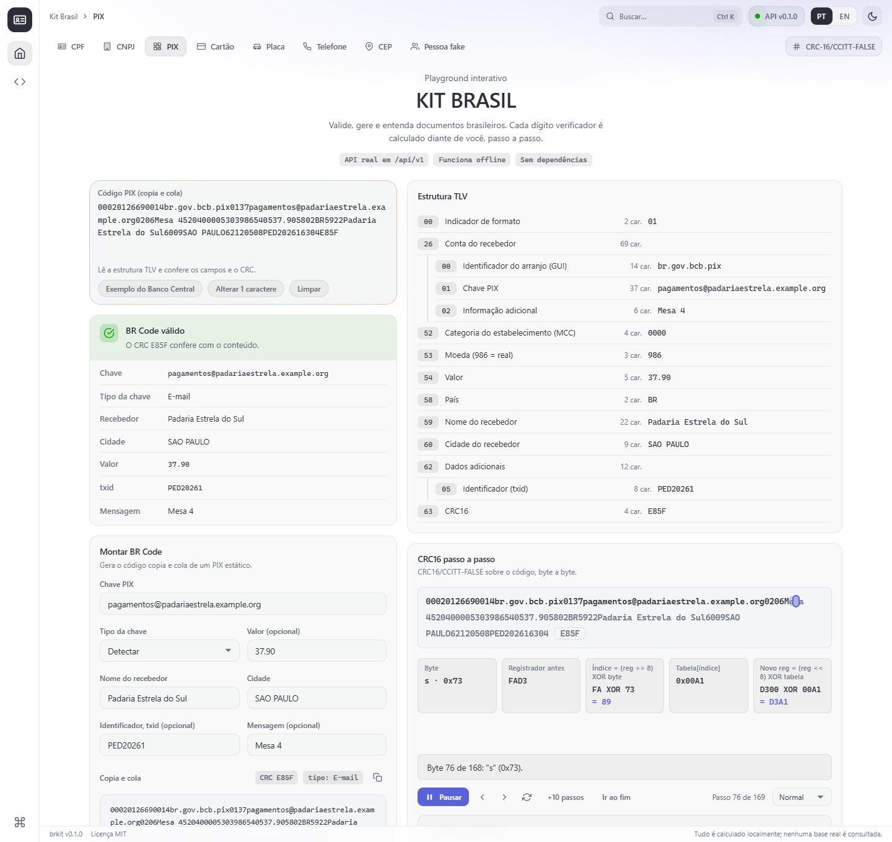
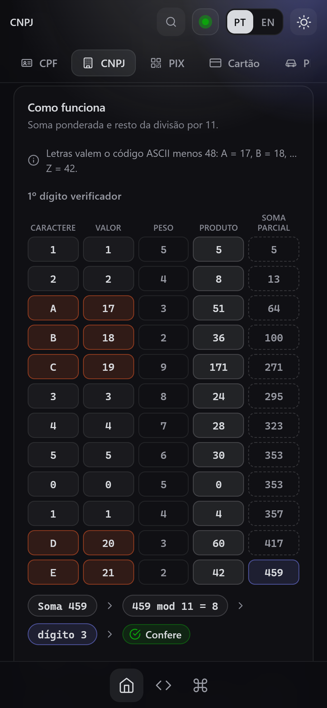
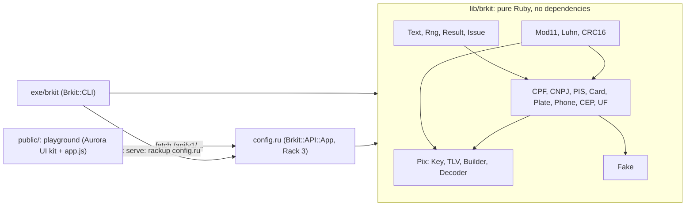

<p align="center">
  
</p>

<p align="center">
  <strong>Validate, generate and understand Brazilian documents: CPF, CNPJ (including the new alphanumeric format), PIX BR Codes, plates, phones, test cards and CEP.</strong><br>
  A zero-dependency Ruby library, a command line, a JSON API and a playground that animates every checksum.
</p>

<p align="center">
  
  
  
  <a href="https://github.com/q6r/brkit/actions/workflows/ci.yml"></a>
</p>

<p align="center"><strong>English</strong> · <a href="README.pt-BR.md">Português</a></p>

<p align="center">
  
</p>

## Why

- **The CNPJ now has letters.** From July 2026 the first twelve characters of a CNPJ may be `A` to `Z`. brkit validates, generates and explains both the classic and the alphanumeric format (a letter is worth its ASCII code minus 48), so a validator written for digits does not reject your new customers.
- **It shows its work.** Every checksum can return its arithmetic as plain data: digits, weights, products, sum, remainder, the Luhn doubling, the CRC register after every byte. The CLI prints it (`--explain`), the API returns it (`explain=true`) and the playground replays it step by step.
- **Nothing to install, nothing to trust.** Pure Ruby with no runtime gem, no network and no database. Generators are seeded and reproducible, and everything they produce is fictitious.

## Features

- **Documents:** CPF (with its fiscal region and states), CNPJ (classic and alphanumeric), PIS/PASEP/NIS/NIT, payment cards (Luhn and brand detection for Visa, Mastercard, Elo, Hipercard, Hiper, American Express, Diners Club, Discover, JCB and UnionPay), licence plates (legacy and Mercosul, with conversion), phone numbers (ANATEL area codes, E.164) and CEP (with the state ranges).
- **PIX:** a static BR Code builder, a decoder that parses the TLV tree and checks the fields against the Banco Central manual, CRC-16/CCITT-FALSE, and key detection (CPF, CNPJ, phone, e-mail or random key).
- **Fictitious people:** seeded names, checksum-valid CPFs, e-mails on reserved `example.*` domains, phones and addresses that agree with each other.
- **Command line** with JSON output, stdin input, colour that respects `NO_COLOR`, shell-friendly exit codes and `--explain`.
- **JSON API** as a plain Rack 3 application: OpenAPI 3.1 generated from the route table, RFC 9457 problem details, a per-client token bucket, opt-in CORS, request ids, strict input limits and security headers.
- **Playground** in Brazilian Portuguese (English on request), laid out like an IDE: a navigation rail, a top bar with breadcrumbs and search, one pill per tool and a status bar. Eight tools, validate as you type, generate, a PIX builder and decoder, a command palette (Ctrl+K), the dark Prism Classic and light Prism Daylight themes, keyboard accessible and reduced-motion safe. It works offline.

## Quick start

```sh
git clone https://github.com/q6r/brkit.git
cd brkit

# 1. The command line runs straight from the checkout: Ruby 3.1+, nothing to install.
ruby -Ilib exe/brkit cpf validate 529.982.247-25

# 2. The playground and the API need a Rack server.
bundle config set --local with server
bundle install
bundle exec rackup config.ru --host 127.0.0.1 --port 9292      # or: bundle exec ruby exe/brkit serve
```

Open <http://127.0.0.1:9292/> for the playground; the API lives under `/api/v1/` and describes itself at `/api/v1/openapi.json`.

The same commands work in Windows PowerShell and in macOS and Linux shells. In PowerShell call `curl.exe` (plain `curl` is an alias of `Invoke-WebRequest`) or use `Invoke-RestMethod "http://127.0.0.1:9292/api/v1/cpf/generate?count=2&seed=1"`.

## Usage

### Library

```ruby
require "brkit"

result = Brkit::CPF.validate("529.982.247-26")
result.valid?                   #=> false
result.normalized               #=> "52998224726"
result.errors.first.code        #=> :checksum
result.errors.first.message     #=> "second check digit does not match (expected 5, got 6)"

# The alphanumeric CNPJ, with the arithmetic.
cnpj = Brkit::CNPJ.validate("12.ABC.345/01DE-35", explain: true)
cnpj.valid?                     #=> true
cnpj.details[:steps].first.slice(:values, :weights, :sum, :remainder, :check_digit)
#=> {values: [1, 2, 17, 18, 19, 3, 4, 5, 0, 1, 20, 21], weights: [5, 4, 3, 2, 9, 8, 7, 6, 5, 4, 3, 2],
#    sum: 459, remainder: 8, check_digit: 3}

# Generators are deterministic: the same seed always gives the same values.
Brkit::CPF.generate(uf: "SP", formatted: true, seed: 7)    #=> "496.337.798-55"
Brkit::Plate.convert("ABC-1234").normalized                 #=> "ABC1C34"

# PIX: build a static BR Code and decode it back.
payload = Brkit::Pix.build(key: "123e4567-e12b-12d1-a456-426655440000", name: "Fulano de Tal",
                           city: "BRASILIA", amount: 12.5, txid: "PED123")
decoded = Brkit::Pix.decode(payload.to_s, explain: true)
decoded.valid?                  #=> true
decoded.details[:crc].except(:steps)    #=> {expected: "6B07", actual: "6B07", valid: true}
decoded.details[:crc][:steps].length    #=> 145, one step per byte of the payload
```

[`examples/quickstart.rb`](examples/quickstart.rb) is a runnable tour (`ruby -Ilib examples/quickstart.rb`), [`examples/validate_csv.rb`](examples/validate_csv.rb) cleans a list of mixed documents, and [`examples/generate_samples.rb`](examples/generate_samples.rb) regenerates the sample data in `examples/samples/`.

### Command line

```text
$ brkit cpf validate 529.982.247-25
valid: 529.982.247-25 (CPF) - fiscal region 7 (ES, RJ)

$ brkit cpf validate 529.982.247-26            # exit status 1
invalid: 529.982.247-26 (CPF)
  - second check digit does not match (expected 5, got 6)

$ brkit cnpj validate 12.ABC.345/01DE-35 --explain
valid: 12.ABC.345/01DE-35 (CNPJ) - alphanumeric
  first check digit:
    chars      1   2   A   B   C   3   4   5   0   1   D   E
    values     1   2  17  18  19   3   4   5   0   1  20  21
    weights    5   4   3   2   9   8   7   6   5   4   3   2
    products   5   8  51  36 171  24  28  30   0   4  60  42
    sum 459; 459 mod 11 = 8; check digit 3 (input has 3: ok)
  second check digit:
    chars     1  2  A  B  C  3  4  5  0  1  D  E  3
    values    1  2 17 18 19  3  4  5  0  1 20 21  3
    weights   6  5  4  3  2  9  8  7  6  5  4  3  2
    products  6 10 68 54 38 27 32 35  0  5 80 63  6
    sum 424; 424 mod 11 = 6; check digit 5 (input has 5: ok)

$ brkit cpf generate --uf SP -n 3 --seed 7 --format
496.337.798-55
898.764.078-72
763.588.758-09

$ brkit cnpj generate --alphanumeric -n 3 --seed 42 --format
SE.7KI.MAA/0001-91
NZ.N2L.1NT/0001-02
1K.WBL.OQR/0001-75

$ brkit plate convert ABC-1234
ABC1C34

$ brkit pix payload --key 123e4567-e12b-12d1-a456-426655440000 --name "Fulano de Tal" --city BRASILIA --amount 12.50 --txid PED123
00020126580014br.gov.bcb.pix0136123e4567-e12b-12d1-a456-426655440000520400005303986540512.505802BR5913Fulano de Tal6008BRASILIA62100506PED12363046B07
```

<p align="center">
  
</p>

Commands: `<document> validate|generate|format` for `cpf`, `cnpj`, `pis`, `card`, `plate`, `phone` and `cep`; `plate convert`; `pix payload` and `pix decode`; `fake person`; `serve`; `completion`. `brkit --help` lists every option. Exit status: `0` success or valid, `1` invalid value, `2` usage error, `3` environment problem (for example `rackup` is missing). Values can be piped in with `-`, `--json` prints one JSON object per value, and `--color auto|always|never` controls colour.

Tab completion: `source <(brkit completion bash)` in bash, and `brkit completion powershell | Out-String | Invoke-Expression` in PowerShell.

### HTTP API

```sh
curl "http://127.0.0.1:9292/api/v1/cpf/validate?cpf=529.982.247-25"
```

```json
{"kind":"cpf","input":"529.982.247-25","valid":true,"normalized":"52998224725","formatted":"529.982.247-25","errors":[],"details":{"region_digit":7,"ufs":["ES","RJ"]}}
```

```sh
curl "http://127.0.0.1:9292/api/v1/cnpj/generate?alphanumeric=true&count=2&seed=42&formatted=true"
```

```json
{"kind":"cnpj","seed":42,"count":2,"items":["SE.7KI.MAA/0001-91","NZ.N2L.1NT/0001-02"]}
```

```sh
curl "http://127.0.0.1:9292/api/v1/cpf/generate?count=500"
```

```json
{"type":"https://github.com/q6r/brkit/blob/main/docs/problems.md#invalid-parameter","title":"Invalid parameter","status":400,"detail":"count must be between 1 and 100","request_id":"70c4b335-914d-41ec-a9b2-e634eafc7b72","errors":[{"code":"out_of_range","message":"count must be between 1 and 100","field":"count"}]}
```

| Endpoint | What it does |
|---|---|
| `GET /api/v1/<document>/validate` | Validate a value; add `explain=true` for the checksum steps (CPF, CNPJ, PIS, card) |
| `GET /api/v1/<document>/generate` | Generate values: `count` (1 to 100), `seed`, and the document's own options |
| `GET /api/v1/plate/convert` | Legacy plate to Mercosul |
| `POST /api/v1/pix/payload` | Build a static BR Code from a JSON body |
| `POST /api/v1/pix/decode` | Decode and check a BR Code; `"explain": true` adds the CRC steps |
| `GET /api/v1/fake/person` | Fictitious people |
| `GET /api/v1/openapi.json`, `GET /healthz` | The OpenAPI 3.1 description, and a liveness probe |

The full reference, with every parameter and response, is in [docs/api.md](docs/api.md); the error types are in [docs/problems.md](docs/problems.md). [`examples/api.sh`](examples/api.sh) and [`examples/api.http`](examples/api.http) call every endpoint.

### Playground

The playground has one tab per tool, as pills under the top bar: **CPF**, **CNPJ**, **PIX**, **Cartão** (card), **Placa** (plate), **Telefone** (phone), **CEP** and **Pessoa fake**. Every tool except the fake person takes its value in a composer at the top left and answers as you type with a clear verdict and the facts it can read from the value; every tool generates values with the library's options (and a seed, so a result can be repeated) and has a "how it works" card that replays the computation:

- **CPF, CNPJ:** a grid of characters, weights and products; the running sum fills in column by column, then `sum mod 11`, the check digit and the verdict. For the alphanumeric CNPJ each letter is shown next to its numeric value.
- **Card:** the Luhn doubling from the right, with the digits that count twice marked.
- **Plate, phone, CEP:** the conversion table from `0..9` to `A..J`, the area-code and type rules, and what each part of a CEP says.
- **PIX:** a builder that produces the copy-and-paste code, a decoder that shows the TLV tree and the CRC verdict, a button that changes one character to watch the CRC fail, and the CRC-16 register stepping through the payload byte by byte.
- **Fake person:** a visible "fictitious data" notice, copy buttons everywhere, and the person's CPF explained like any other.

Play, pause, step back and forth, restart and change the speed; with `prefers-reduced-motion` the animation starts at its final state. Press `Ctrl+K` for the command palette, `PT` or `EN` to switch language (remembered in `localStorage`), and the sun/moon button for the theme. The tool is part of the URL (`#cnpj`, `#pix`, ...), so it can be linked and the back button works. The page never recomputes a check digit: sums, remainders, digits and CRC registers all come from the API's `explain` data. Without the API (the page opened from disk, or the server stopped) the playground still loads and says so; the rail's second item opens the OpenAPI description.

<p align="center">
  
</p>

<p align="center">
  
  
</p>

<p align="center">
  
</p>

## Architecture



Validators never raise on bad input: they return an immutable `Result` with stable error codes. Checksums are data (`Mod11.step`, `Luhn.steps`, `CRC16.trace`), so the CLI, the API and the playground render the same hashes. One route table drives request validation and the generated OpenAPI document. See [docs/architecture.md](docs/architecture.md) for the request path, [docs/algorithms.md](docs/algorithms.md) for the mod-11, Luhn, CRC-16 and TLV details with worked examples, and [docs/pix-qr.md](docs/pix-qr.md) for how a BR Code becomes a QR image.

## Project layout

```text
brkit/
├── exe/brkit                  command line entry point
├── config.ru                  Rack entry point: the API and the playground
├── lib/
│   ├── brkit.rb               the library; requires every document
│   └── brkit/
│       ├── cpf.rb cnpj.rb pis.rb card.rb plate.rb phone.rb cep.rb uf.rb
│       ├── mod11.rb luhn.rb crc16.rb     checksum primitives that return their steps
│       ├── pix.rb pix/                   key, tlv, builder, decoder
│       ├── fake.rb fake/data.rb          seeded fictitious people
│       ├── cli.rb cli/                   the command line (explain, style, completion)
│       └── api.rb api/                   the Rack application
├── public/                    the playground: index.html, app.js, app.css, the bundled Aurora UI kit
├── test/                      Minitest suite; all.rb lists every file
├── docs/                      architecture, algorithms, api, problems, pix-qr, screenshots
├── examples/                  runnable scripts, curl and .http files, generated samples
├── assets/banner.svg
└── brkit.gemspec  Gemfile  Rakefile  .rubocop.yml  .ruby-version
```

## Configuration

The API reads these environment variables when it starts; a bad value stops the boot with a message that names the variable.

| Variable | Meaning | Default |
|---|---|---|
| `BRKIT_CORS_ORIGIN` | Comma-separated origins allowed to call the API from a browser, or `*` | none (CORS off) |
| `BRKIT_MAX_BODY_BYTES` | Largest accepted request body (1 to 1 048 576) | `16384` |
| `BRKIT_RATE_LIMIT` | Sustained requests per minute per client for `/api/`; `0` turns limiting off | `120` |
| `BRKIT_RATE_BURST` | Token-bucket size: requests allowed in a burst | `40` |
| `BRKIT_TRUST_PROXY` | `1` to take the client address from the right-most `X-Forwarded-For` entry | off |

`brkit serve` takes `--host` (default `127.0.0.1`) and `--port` (default `9292`) and hands over to `rackup`.

## Security

- **Loopback by default.** `brkit serve` binds `127.0.0.1`. Expose it deliberately, and behind a reverse proxy set `BRKIT_TRUST_PROXY=1` only if the proxy is the only way in.
- **Strict page policy.** HTML is served with `default-src 'self'; script-src 'self'; style-src 'self'; connect-src 'self'; object-src 'none'; frame-ancestors 'none'`. The playground has no inline script or style, makes no request to another origin and builds no HTML from data (every string goes through `textContent`); a test fails if that changes.
- **Bounded input.** Validators examine at most 256 characters; the API refuses values over 512, bodies over 16 KiB by default, JSON nested more than 8 levels, more than 32 query parameters, and asks for at most 100 generated items. JSON is parsed without object creation, and malformed percent-encoding, control characters and invalid UTF-8 are rejected.
- **Safe static files.** Only plain file names, no dotfiles, the resolved real path must stay inside `public/` (symbolic links cannot escape), regular files up to 5 MiB.
- **Quiet failures.** An unexpected error is an opaque `500` with a request id; the detail goes to the server log.
- **Rate limiting** per client address (token bucket) on `/api/`; CORS is off unless configured and never allows credentials.
- **Fictitious data only.** Generated CPFs, CNPJs and cards pass the checksum but are random: one may coincide with a real registration by chance, generated phone numbers may belong to real subscribers, and test cards must never be used for real payments. Do not put real personal data in tests or issues.

Report vulnerabilities privately; see [SECURITY.md](SECURITY.md).

## Testing

```sh
bundle exec rake                       # the tests, then RuboCop
bundle exec rake test                  # the tests only
ruby -Ilib -Itest test/all.rb          # the same tests without Bundler
```

The suite has more than 500 tests and over 46,000 assertions, runs in a few seconds and needs no network: seeded generators, an injectable clock for the rate limiter, hand-built Rack environments (the `rack` gem is not needed to run the tests) and tests for the awkward cases: hostile input, control characters, invalid UTF-8, and every single-character change of a PIX payload. `test/playground_test.rb` checks the page's contract with the server (no inline code, same origin only, matching Portuguese and English texts, and that every text the script asks for exists). CI runs the suite on Ruby 3.1 to 3.4 (plus macOS and Windows), RuboCop, and a smoke test that boots `rackup` and calls the API and the playground.

## Roadmap

- Publish `0.1.0` to RubyGems.
- More documents: RENAVAM, CNH and título de eleitor.
- Dynamic PIX payloads (a payload URL instead of a static key).
- A small QR renderer for BR Codes (today the payload is meant to be fed to any QR encoder, see [docs/pix-qr.md](docs/pix-qr.md)).
- `Accept-Language` for the API's error messages.

## Contributing

Issues and pull requests are welcome. [CONTRIBUTING.md](CONTRIBUTING.md) explains the setup, the test and lint commands and the commit style (Conventional Commits). Please keep the library free of runtime dependencies.

## License

[MIT](LICENSE) © 2026 q6r.

## Credits

- The Banco Central do Brasil, for the *Manual de Padrões para Iniciação do Pix* and the BR Code manual: its static example (CRC `1D3D`) is a test vector, and the decoder checks the rules it states.
- The Receita Federal do Brasil, for the alphanumeric CNPJ specification.
- The EMV QR Code (TLV) format, the CRC-16/CCITT-FALSE catalogue entry (check value `0x29B1`) and Hans Peter Luhn's mod-10 algorithm.
- The playground uses the Aurora UI kit bundled in `public/` (`aurora.css` and `aurora.js`: zero dependencies, MIT, part of this repository).
