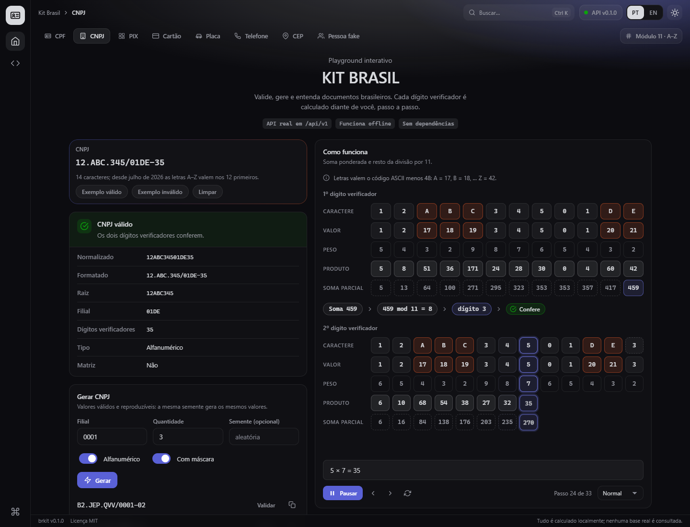
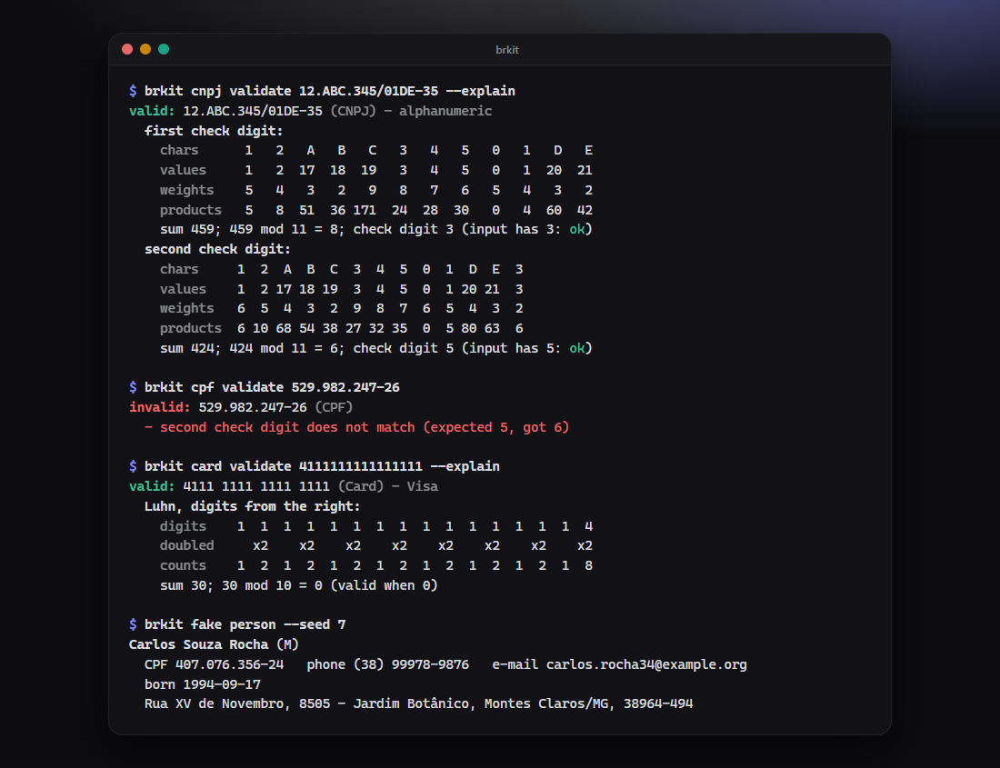
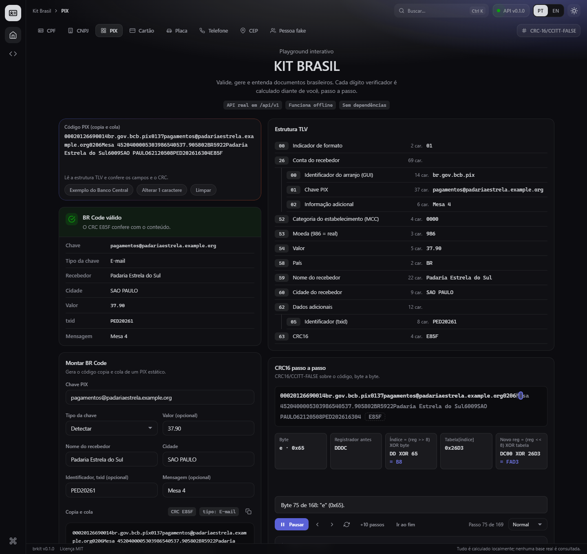
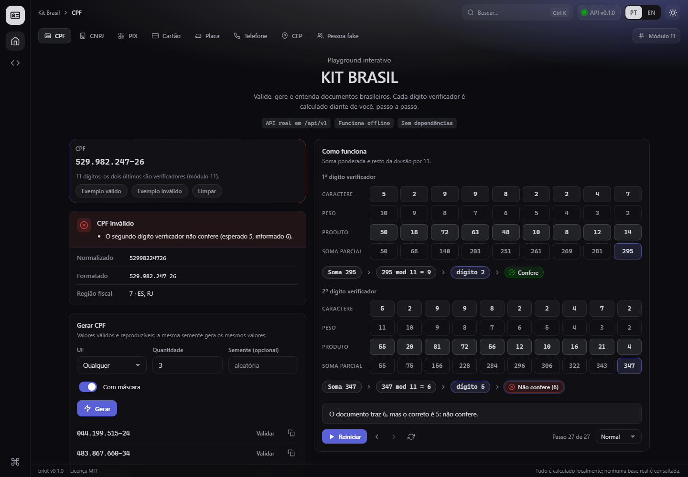
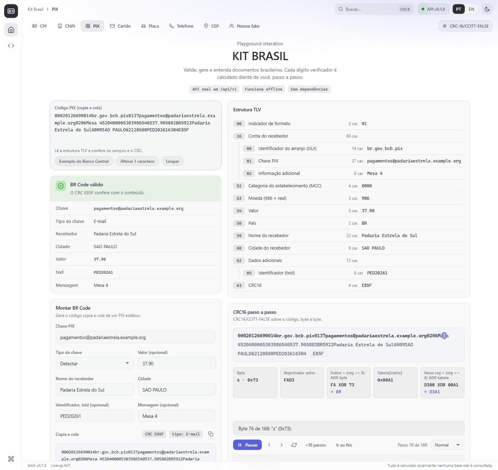
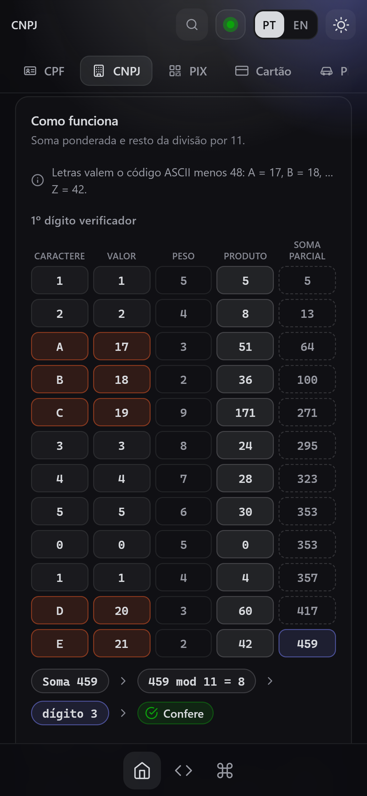
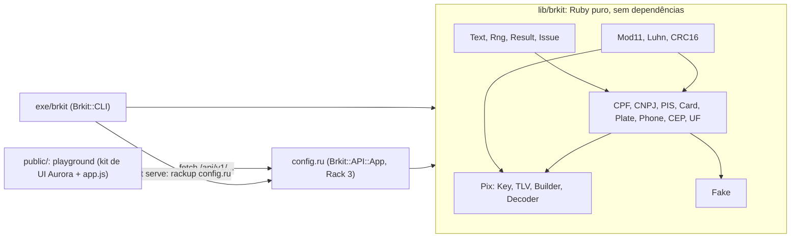

<p align="center">
  
</p>

<p align="center">
  <strong>Valide, gere e entenda documentos brasileiros: CPF, CNPJ (inclusive o novo formato alfanumérico), BR Codes do PIX, placas, telefones, cartões de teste e CEP.</strong><br>
  Uma biblioteca Ruby sem dependências, uma linha de comando, uma API JSON e um playground que anima cada dígito verificador.
</p>

<p align="center">
  
  
  
  <a href="https://github.com/q6r/brkit/actions/workflows/ci.yml"></a>
</p>

<p align="center"><a href="README.md">English</a> · <strong>Português</strong></p>

<p align="center">
  
</p>

## Por quê

- **O CNPJ agora tem letras.** A partir de julho de 2026, os doze primeiros caracteres do CNPJ podem ser de `A` a `Z`. O brkit valida, gera e explica os dois formatos, o clássico e o alfanumérico (cada letra vale o código ASCII menos 48), para que um validador pensado só para dígitos não recuse seus novos clientes.
- **Ele mostra a conta.** Todo cálculo pode devolver a aritmética como dado simples: dígitos, pesos, produtos, soma, resto, a dobra do Luhn e o registrador do CRC depois de cada byte. A linha de comando imprime (`--explain`), a API devolve (`explain=true`) e o playground reproduz passo a passo.
- **Nada para instalar, nada em que confiar.** Ruby puro, sem gems em tempo de execução, sem rede e sem banco de dados. Os geradores usam semente e são reproduzíveis, e tudo o que produzem é fictício.

## Recursos

- **Documentos:** CPF (com região fiscal e estados), CNPJ (clássico e alfanumérico), PIS/PASEP/NIS/NIT, cartões (Luhn e detecção de bandeira: Visa, Mastercard, Elo, Hipercard, Hiper, American Express, Diners Club, Discover, JCB e UnionPay), placas (antigas e Mercosul, com conversão), telefones (DDDs da Anatel, E.164) e CEP (com as faixas por estado).
- **PIX:** montador de BR Code estático, decodificador que lê a árvore TLV e confere os campos conforme o manual do Banco Central, CRC-16/CCITT-FALSE e detecção do tipo de chave (CPF, CNPJ, telefone, e-mail ou chave aleatória).
- **Pessoas fictícias:** nomes gerados por semente, CPFs com dígitos válidos, e-mails em domínios reservados `example.*`, telefones e endereços coerentes entre si.
- **Linha de comando** com saída JSON, entrada por stdin, cores que respeitam `NO_COLOR`, códigos de saída próprios para scripts e `--explain`.
- **API JSON** como aplicação Rack 3 simples: OpenAPI 3.1 gerado a partir da tabela de rotas, erros no formato RFC 9457, limite de requisições por cliente (token bucket), CORS opcional, ids de requisição, limites rígidos de entrada e cabeçalhos de segurança.
- **Playground** em português do Brasil (inglês sob demanda), organizado como uma IDE: barra de navegação lateral, barra superior com trilha de navegação e busca, uma pílula por ferramenta e uma barra de status. Oito ferramentas, validação enquanto você digita, geração, montador e decodificador de PIX, paleta de comandos (Ctrl+K), os temas Prism Classic (escuro) e Prism Daylight (claro), acessível por teclado e seguro para quem prefere menos movimento. Funciona offline.

## Início rápido

```sh
git clone https://github.com/q6r/brkit.git
cd brkit

# 1. A linha de comando roda direto do clone: Ruby 3.1+, sem instalar nada.
ruby -Ilib exe/brkit cpf validate 529.982.247-25

# 2. O playground e a API precisam de um servidor Rack.
bundle config set --local with server
bundle install
bundle exec rackup config.ru --host 127.0.0.1 --port 9292      # ou: bundle exec ruby exe/brkit serve
```

Abra <http://127.0.0.1:9292/> para o playground; a API fica em `/api/v1/` e se descreve em `/api/v1/openapi.json`.

Os mesmos comandos funcionam no Windows PowerShell e em shells de macOS e Linux. No PowerShell use `curl.exe` (o `curl` puro é um apelido de `Invoke-WebRequest`) ou `Invoke-RestMethod "http://127.0.0.1:9292/api/v1/cpf/generate?count=2&seed=1"`.

## Uso

### Biblioteca

```ruby
require "brkit"

result = Brkit::CPF.validate("529.982.247-26")
result.valid?                   #=> false
result.normalized               #=> "52998224726"
result.errors.first.code        #=> :checksum
result.errors.first.message     #=> "second check digit does not match (expected 5, got 6)"

# O CNPJ alfanumérico, com a aritmética.
cnpj = Brkit::CNPJ.validate("12.ABC.345/01DE-35", explain: true)
cnpj.valid?                     #=> true
cnpj.details[:steps].first.slice(:values, :weights, :sum, :remainder, :check_digit)
#=> {values: [1, 2, 17, 18, 19, 3, 4, 5, 0, 1, 20, 21], weights: [5, 4, 3, 2, 9, 8, 7, 6, 5, 4, 3, 2],
#    sum: 459, remainder: 8, check_digit: 3}

# Os geradores são determinísticos: a mesma semente sempre dá os mesmos valores.
Brkit::CPF.generate(uf: "SP", formatted: true, seed: 7)    #=> "496.337.798-55"
Brkit::Plate.convert("ABC-1234").normalized                 #=> "ABC1C34"

# PIX: monte um BR Code estático e decodifique de volta.
payload = Brkit::Pix.build(key: "123e4567-e12b-12d1-a456-426655440000", name: "Fulano de Tal",
                           city: "BRASILIA", amount: 12.5, txid: "PED123")
decoded = Brkit::Pix.decode(payload.to_s, explain: true)
decoded.valid?                  #=> true
decoded.details[:crc].except(:steps)    #=> {expected: "6B07", actual: "6B07", valid: true}
decoded.details[:crc][:steps].length    #=> 145, um passo por byte do código
```

[`examples/quickstart.rb`](examples/quickstart.rb) é um roteiro executável (`ruby -Ilib examples/quickstart.rb`), [`examples/validate_csv.rb`](examples/validate_csv.rb) limpa uma lista de documentos variados e [`examples/generate_samples.rb`](examples/generate_samples.rb) regenera os dados de exemplo em `examples/samples/`. As mensagens de erro da biblioteca, da CLI e da API estão em inglês e têm códigos estáveis (`checksum`, `invalid_length`, ...); o playground as traduz.

### Linha de comando

```text
$ brkit cpf validate 529.982.247-25
valid: 529.982.247-25 (CPF) - fiscal region 7 (ES, RJ)

$ brkit cpf validate 529.982.247-26            # código de saída 1
invalid: 529.982.247-26 (CPF)
  - second check digit does not match (expected 5, got 6)

$ brkit cnpj validate 12.ABC.345/01DE-35 --explain
valid: 12.ABC.345/01DE-35 (CNPJ) - alphanumeric
  first check digit:
    chars      1   2   A   B   C   3   4   5   0   1   D   E
    values     1   2  17  18  19   3   4   5   0   1  20  21
    weights    5   4   3   2   9   8   7   6   5   4   3   2
    products   5   8  51  36 171  24  28  30   0   4  60  42
    sum 459; 459 mod 11 = 8; check digit 3 (input has 3: ok)
  second check digit:
    chars     1  2  A  B  C  3  4  5  0  1  D  E  3
    values    1  2 17 18 19  3  4  5  0  1 20 21  3
    weights   6  5  4  3  2  9  8  7  6  5  4  3  2
    products  6 10 68 54 38 27 32 35  0  5 80 63  6
    sum 424; 424 mod 11 = 6; check digit 5 (input has 5: ok)

$ brkit cpf generate --uf SP -n 3 --seed 7 --format
496.337.798-55
898.764.078-72
763.588.758-09

$ brkit cnpj generate --alphanumeric -n 3 --seed 42 --format
SE.7KI.MAA/0001-91
NZ.N2L.1NT/0001-02
1K.WBL.OQR/0001-75

$ brkit plate convert ABC-1234
ABC1C34

$ brkit pix payload --key 123e4567-e12b-12d1-a456-426655440000 --name "Fulano de Tal" --city BRASILIA --amount 12.50 --txid PED123
00020126580014br.gov.bcb.pix0136123e4567-e12b-12d1-a456-426655440000520400005303986540512.505802BR5913Fulano de Tal6008BRASILIA62100506PED12363046B07
```

<p align="center">
  
</p>

Comandos: `<documento> validate|generate|format` para `cpf`, `cnpj`, `pis`, `card`, `plate`, `phone` e `cep`; `plate convert`; `pix payload` e `pix decode`; `fake person`; `serve`; `completion`. `brkit --help` lista todas as opções. Código de saída: `0` sucesso ou válido, `1` valor inválido, `2` erro de uso, `3` problema de ambiente (por exemplo, falta o `rackup`). Valores podem vir por pipe com `-`, `--json` imprime um objeto JSON por valor e `--color auto|always|never` controla as cores.

Completar com Tab: `source <(brkit completion bash)` no bash e `brkit completion powershell | Out-String | Invoke-Expression` no PowerShell.

### API HTTP

```sh
curl "http://127.0.0.1:9292/api/v1/cpf/validate?cpf=529.982.247-25"
```

```json
{"kind":"cpf","input":"529.982.247-25","valid":true,"normalized":"52998224725","formatted":"529.982.247-25","errors":[],"details":{"region_digit":7,"ufs":["ES","RJ"]}}
```

```sh
curl "http://127.0.0.1:9292/api/v1/cnpj/generate?alphanumeric=true&count=2&seed=42&formatted=true"
```

```json
{"kind":"cnpj","seed":42,"count":2,"items":["SE.7KI.MAA/0001-91","NZ.N2L.1NT/0001-02"]}
```

```sh
curl "http://127.0.0.1:9292/api/v1/cpf/generate?count=500"
```

```json
{"type":"https://github.com/q6r/brkit/blob/main/docs/problems.md#invalid-parameter","title":"Invalid parameter","status":400,"detail":"count must be between 1 and 100","request_id":"70c4b335-914d-41ec-a9b2-e634eafc7b72","errors":[{"code":"out_of_range","message":"count must be between 1 and 100","field":"count"}]}
```

| Endpoint | O que faz |
|---|---|
| `GET /api/v1/<documento>/validate` | Valida um valor; `explain=true` acrescenta os passos do cálculo (CPF, CNPJ, PIS, cartão) |
| `GET /api/v1/<documento>/generate` | Gera valores: `count` (1 a 100), `seed` e as opções de cada documento |
| `GET /api/v1/plate/convert` | Placa antiga para Mercosul |
| `POST /api/v1/pix/payload` | Monta um BR Code estático a partir de um corpo JSON |
| `POST /api/v1/pix/decode` | Decodifica e confere um BR Code; `"explain": true` acrescenta os passos do CRC |
| `GET /api/v1/fake/person` | Pessoas fictícias |
| `GET /api/v1/openapi.json`, `GET /healthz` | A descrição OpenAPI 3.1 e um teste de vida |

A referência completa, com todos os parâmetros e respostas, está em [docs/api.md](docs/api.md); os tipos de erro estão em [docs/problems.md](docs/problems.md) (em inglês). [`examples/api.sh`](examples/api.sh) e [`examples/api.http`](examples/api.http) chamam todos os endpoints.

### Playground

O playground tem uma aba por ferramenta, em forma de pílulas sob a barra superior: **CPF**, **CNPJ**, **PIX**, **Cartão**, **Placa**, **Telefone**, **CEP** e **Pessoa fake**. Todas as ferramentas, menos a pessoa fake, recebem o valor em um campo no alto à esquerda e respondem enquanto você digita com um veredito claro e os fatos que dá para ler do valor; todas geram valores com as opções da biblioteca (e uma semente, para repetir um resultado) e têm um cartão "Como funciona" que reproduz o cálculo:

- **CPF, CNPJ:** uma grade de caracteres, pesos e produtos; a soma parcial vai sendo preenchida coluna a coluna, depois `soma mod 11`, o dígito verificador e o veredito. No CNPJ alfanumérico, cada letra aparece ao lado do seu valor numérico.
- **Cartão:** a dobra do Luhn, da direita para a esquerda, com os dígitos que contam em dobro marcados.
- **Placa, telefone, CEP:** a tabela de conversão de `0..9` para `A..J`, as regras de DDD e de tipo de número, e o que cada parte do CEP informa.
- **PIX:** um montador que gera o código copia e cola, um decodificador que mostra a árvore TLV e o veredito do CRC, um botão que altera um caractere para você ver o CRC falhar, e o registrador do CRC-16 percorrendo o código byte a byte.
- **Pessoa fake:** um aviso visível de "dados fictícios", botões de copiar em todo lugar e o CPF da pessoa explicado como qualquer outro.

Reproduza, pause, volte e avance passo a passo, reinicie e mude a velocidade; com `prefers-reduced-motion` a animação já começa no estado final. `Ctrl+K` abre a paleta de comandos, `PT` e `EN` trocam o idioma (guardado no `localStorage`) e o botão de sol/lua troca o tema. A ferramenta faz parte da URL (`#cnpj`, `#pix`, ...), então dá para compartilhar o link e o botão de voltar funciona. A página nunca recalcula um dígito verificador: somas, restos, dígitos e registradores do CRC vêm todos dos dados `explain` da API. Sem a API (página aberta direto do disco, ou servidor parado) o playground carrega e avisa; o segundo item da barra lateral abre a descrição OpenAPI.

<p align="center">
  
</p>

<p align="center">
  
  
</p>

<p align="center">
  
</p>

## Arquitetura



Os validadores nunca levantam exceção por entrada ruim: devolvem um `Result` imutável com códigos de erro estáveis. Os cálculos são dados (`Mod11.step`, `Luhn.steps`, `CRC16.trace`), então a CLI, a API e o playground exibem os mesmos hashes. Uma única tabela de rotas valida as requisições e gera o documento OpenAPI. Veja [docs/architecture.md](docs/architecture.md) para o caminho de uma requisição, [docs/algorithms.md](docs/algorithms.md) para os detalhes de módulo 11, Luhn, CRC-16 e TLV com exemplos resolvidos, e [docs/pix-qr.md](docs/pix-qr.md) para ver como um BR Code vira uma imagem de QR (a documentação técnica está em inglês).

## Estrutura do projeto

```text
brkit/
├── exe/brkit                  ponto de entrada da linha de comando
├── config.ru                  ponto de entrada Rack: a API e o playground
├── lib/
│   ├── brkit.rb               a biblioteca; carrega todos os documentos
│   └── brkit/
│       ├── cpf.rb cnpj.rb pis.rb card.rb plate.rb phone.rb cep.rb uf.rb
│       ├── mod11.rb luhn.rb crc16.rb     primitivas de cálculo que devolvem seus passos
│       ├── pix.rb pix/                   chave, tlv, montador, decodificador
│       ├── fake.rb fake/data.rb          pessoas fictícias por semente
│       ├── cli.rb cli/                   a linha de comando (explain, style, completion)
│       └── api.rb api/                   a aplicação Rack
├── public/                    o playground: index.html, app.js, app.css, o kit de UI Aurora incluído
├── test/                      suíte Minitest; all.rb lista todos os arquivos
├── docs/                      arquitetura, algoritmos, api, problemas, pix-qr, capturas de tela
├── examples/                  scripts executáveis, arquivos curl e .http, amostras geradas
├── assets/banner.svg
└── brkit.gemspec  Gemfile  Rakefile  .rubocop.yml  .ruby-version
```

## Configuração

A API lê estas variáveis de ambiente ao iniciar; um valor inválido interrompe a inicialização com uma mensagem que cita a variável.

| Variável | Significado | Padrão |
|---|---|---|
| `BRKIT_CORS_ORIGIN` | Origens, separadas por vírgula, autorizadas a chamar a API de um navegador, ou `*` | nenhuma (CORS desligado) |
| `BRKIT_MAX_BODY_BYTES` | Maior corpo de requisição aceito (1 a 1 048 576) | `16384` |
| `BRKIT_RATE_LIMIT` | Requisições por minuto sustentadas por cliente em `/api/`; `0` desliga o limite | `120` |
| `BRKIT_RATE_BURST` | Tamanho do balde: requisições permitidas em uma rajada | `40` |
| `BRKIT_TRUST_PROXY` | `1` para usar o endereço do cliente da última entrada de `X-Forwarded-For` | desligado |

`brkit serve` aceita `--host` (padrão `127.0.0.1`) e `--port` (padrão `9292`) e passa o controle ao `rackup`.

## Segurança

- **Somente loopback por padrão.** O `brkit serve` escuta em `127.0.0.1`. Exponha de propósito e, atrás de um proxy reverso, use `BRKIT_TRUST_PROXY=1` só se o proxy for a única entrada.
- **Política de página rígida.** O HTML é servido com `default-src 'self'; script-src 'self'; style-src 'self'; connect-src 'self'; object-src 'none'; frame-ancestors 'none'`. O playground não tem script nem estilo inline, não faz requisição a outra origem e não monta HTML a partir de dados (todo texto passa por `textContent`); um teste falha se isso mudar.
- **Entrada limitada.** Os validadores examinam no máximo 256 caracteres; a API recusa valores com mais de 512, corpos acima de 16 KiB por padrão, JSON com mais de 8 níveis, mais de 32 parâmetros na consulta, e entrega no máximo 100 itens gerados. O JSON é lido sem criação de objetos, e percent-encoding malformado, caracteres de controle e UTF-8 inválido são rejeitados.
- **Arquivos estáticos seguros.** Só nomes simples, sem arquivos ocultos, o caminho real resolvido precisa ficar dentro de `public/` (links simbólicos não escapam) e só arquivos regulares de até 5 MiB.
- **Falhas discretas.** Um erro inesperado vira um `500` opaco com um id de requisição; o detalhe vai para o log do servidor.
- **Limite de requisições** por endereço de cliente (token bucket) em `/api/`; o CORS fica desligado até ser configurado e nunca permite credenciais.
- **Somente dados fictícios.** CPFs, CNPJs e cartões gerados passam na verificação, mas são aleatórios: um deles pode coincidir por acaso com um cadastro real, telefones gerados podem pertencer a assinantes reais e cartões de teste jamais devem ser usados em pagamentos reais. Não coloque dados pessoais reais em testes ou issues.

Relate vulnerabilidades em particular; veja [SECURITY.md](SECURITY.md).

## Testes

```sh
bundle exec rake                       # os testes e depois o RuboCop
bundle exec rake test                  # só os testes
ruby -Ilib -Itest test/all.rb          # os mesmos testes sem o Bundler
```

A suíte tem mais de 500 testes e mais de 46 mil asserções, roda em poucos segundos e não usa rede: geradores com semente, relógio injetável no limitador de requisições, ambientes Rack montados à mão (a gem `rack` não é necessária para rodar os testes) e testes para os casos incômodos: entrada hostil, caracteres de controle, UTF-8 inválido e cada alteração de um único caractere em um código PIX. O `test/playground_test.rb` confere o contrato da página com o servidor (sem código inline, só a mesma origem, textos em português e inglês com as mesmas chaves e todo texto que o script pede existente). A CI roda a suíte no Ruby 3.1 a 3.4 (mais macOS e Windows), o RuboCop e um teste de fumaça que sobe o `rackup` e chama a API e o playground.

## Roteiro

- Publicar a `0.1.0` no RubyGems.
- Mais documentos: RENAVAM, CNH e título de eleitor.
- Cobranças PIX dinâmicas (uma URL de payload no lugar da chave estática).
- Um pequeno renderizador de QR para BR Codes (hoje o payload deve ser entregue a qualquer codificador de QR; veja [docs/pix-qr.md](docs/pix-qr.md)).
- `Accept-Language` para as mensagens de erro da API.

## Contribuindo

Issues e pull requests são bem-vindos. O [CONTRIBUTING.md](CONTRIBUTING.md) explica a preparação do ambiente, os comandos de teste e de lint e o estilo de commit (Conventional Commits). Mantenha a biblioteca sem dependências de execução.

## Licença

[MIT](LICENSE) © 2026 q6r.

## Créditos

- O Banco Central do Brasil, pelo *Manual de Padrões para Iniciação do Pix* e pelo manual do BR Code: o exemplo estático dele (CRC `1D3D`) é um vetor de teste, e o decodificador confere as regras que o manual enuncia.
- A Receita Federal do Brasil, pela especificação do CNPJ alfanumérico.
- O formato EMV QR Code (TLV), a entrada CRC-16/CCITT-FALSE do catálogo de CRCs (valor de verificação `0x29B1`) e o algoritmo de módulo 10 de Hans Peter Luhn.
- O playground usa o kit de UI Aurora incluído em `public/` (`aurora.css` e `aurora.js`: sem dependências, MIT, parte deste repositório).
