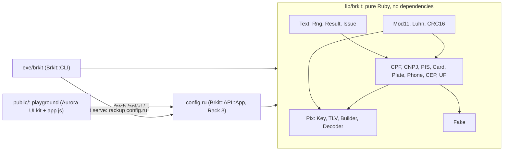
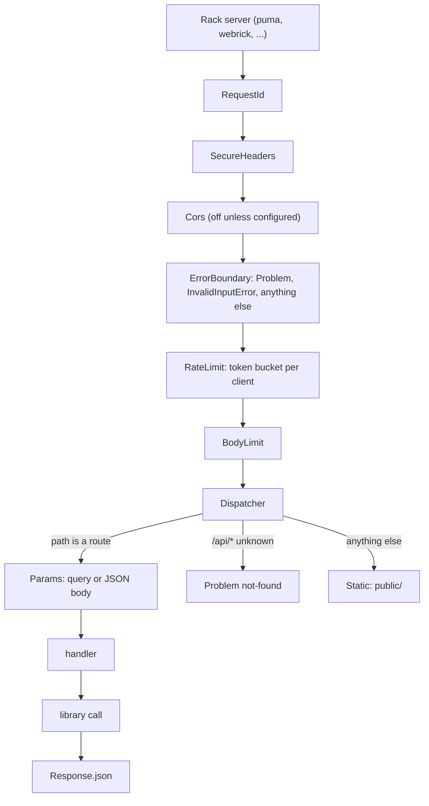
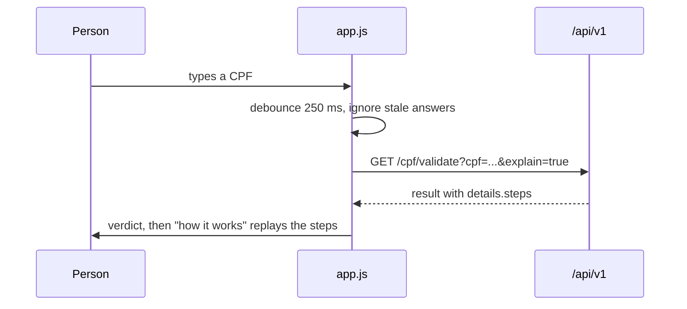

# Architecture

brkit is four layers around one idea: a document is checked by a small, pure function that returns data, and
everything else (the command line, the HTTP API, the playground) is a thin presentation of that data.



| Layer | Where | Responsibility |
|---|---|---|
| Library | `lib/brkit/*.rb`, `lib/brkit/pix/`, `lib/brkit/fake/` | Validate, generate and format. No I/O, no globals, no dependencies. |
| CLI | `lib/brkit/cli.rb`, `exe/brkit` | Argument parsing and text output. `CLI.start` returns an exit status and takes its IO objects, so it is testable and embeddable. |
| HTTP API | `lib/brkit/api/`, `config.ru` | A Rack 3 application: routing, strict parameter parsing, problem documents, rate limiting, static files. |
| Playground | `public/` | A static page that talks to the API and animates the `explain` data. No build step. |

## The library

Every validator has the same shape and returns an immutable `Brkit::Result`:

```ruby
result = Brkit::CPF.validate("529.982.247-25", explain: true)
result.valid?      #=> true
result.normalized  #=> "52998224725"
result.errors      #=> []
result.details     #=> { region_digit: 7, ufs: ["ES", "RJ"], steps: [...] }
```

- **Validators never raise** on bad input: a wrong length, a repeated-digit CPF or invalid UTF-8 are *results*
  (`errors` with a stable `code`). Generators and builders raise `Brkit::InvalidInputError` listing every problem.
- **Checksums are data.** `Mod11.step` returns the characters, weights, products, sum, remainder and resulting digit
  of one check digit; `Luhn.steps` the doubling; `CRC16.trace` the register after every byte. The CLI's
  `--explain`, the API's `explain=true` and the playground's animations all render the same hashes.
- **Generators are deterministic.** Every one takes `seed:` or `rng:` and draws values in a fixed order, which is
  part of the contract: the same seed gives the same CPF, the same person, forever.
- **Normalised once.** `Text.coerce` turns any input (including binary strings and invalid UTF-8) into a safe
  string before a validator looks at it.

## The HTTP API

One route table drives everything. `Endpoints.build` registers each route with its parameter declarations; the same
declarations validate requests (`Params`) and generate the OpenAPI document (`OpenAPI.build`), so the documentation
cannot drift from the behaviour.



- Everything that is not a success is a `Problem` (RFC 9457) raised anywhere below `ErrorBoundary` and rendered
  there; unexpected exceptions become an opaque `500` and the detail goes to the log, keyed by the request id.
- `Request` does the defensive parsing: path and query must be percent-encoded ASCII, decoded text must be valid
  UTF-8 without control characters, bodies are read with a hard limit, JSON is parsed without object creation and
  with a nesting limit.
- `Static` maps a URL path to a file only if every segment is a plain name, the resolved real path stays inside
  `public/` and the file is a regular file under 5 MiB. HTML gets a strict Content-Security-Policy.
- The rate limiter is a token bucket per client address with an injectable clock (the tests move time by hand). It
  covers `/api/` only: static files and `/healthz` are not counted, so loading the playground cannot exhaust the
  budget of the calls the page then makes.
- The application is a plain object that answers `call(env)`; the test suite drives it with hand-built Rack
  environments, so no Rack gem is needed to run the tests, only to serve.

## The playground

`public/index.html` loads the bundled Aurora UI kit (`aurora.css`, `aurora.js`) and `app.css` / `app.js`, and is
otherwise an empty page: `Aurora.shell` builds the navigation rail, the top bar (breadcrumbs, search, API state,
language and theme), the tool pills and the status bar, and `app.js` fills the content. There is no inline script or
style, no CDN and no web font, so the page works under the server's policy (`script-src 'self'; style-src 'self'`)
and offline.



- All text is set with `textContent` (through Aurora's builders); API data is never turned into HTML.
- Texts live in one dictionary per language (Portuguese by default, English on request, remembered in
  `localStorage`); a test checks that both have the same keys. Every label the shell shows (rail tooltips,
  breadcrumbs, search, status bar, the kit's own palette and table labels) comes from it, so a language switch
  updates all of them.
- The tool is the URL hash (`#cpf`, `#pix`, ...): the pills are links, the back button works, and each tool is built
  the first time it is shown. A first probe (`/healthz`) tells the tools whether an API answers; without one they
  say so instead of failing call by call.
- The animations replay data the API returned. The page does not reimplement any checksum, so what you watch is
  what the library computed.

## Project layout

```text
brkit/
  exe/brkit                  command line entry point
  config.ru                  Rack entry point (API + playground)
  lib/brkit.rb               the library; requires every document
  lib/brkit/
    cpf.rb cnpj.rb pis.rb    documents with mod-11 check digits
    card.rb luhn.rb          payment cards: brands and Luhn
    plate.rb phone.rb cep.rb uf.rb
    mod11.rb crc16.rb        the checksum primitives (with step data)
    pix.rb pix/              BR Code: key, tlv, builder, decoder
    fake.rb fake/data.rb     seeded fictitious people
    result.rb errors.rb text.rb rng.rb version.rb
    cli.rb cli/explain.rb    the command line
    api.rb api/              the Rack application
  public/                    the playground (Aurora UI kit + app.js)
  test/                      Minitest; all.rb lists every file
  docs/                      this folder
  examples/                  runnable examples and generated samples
```
